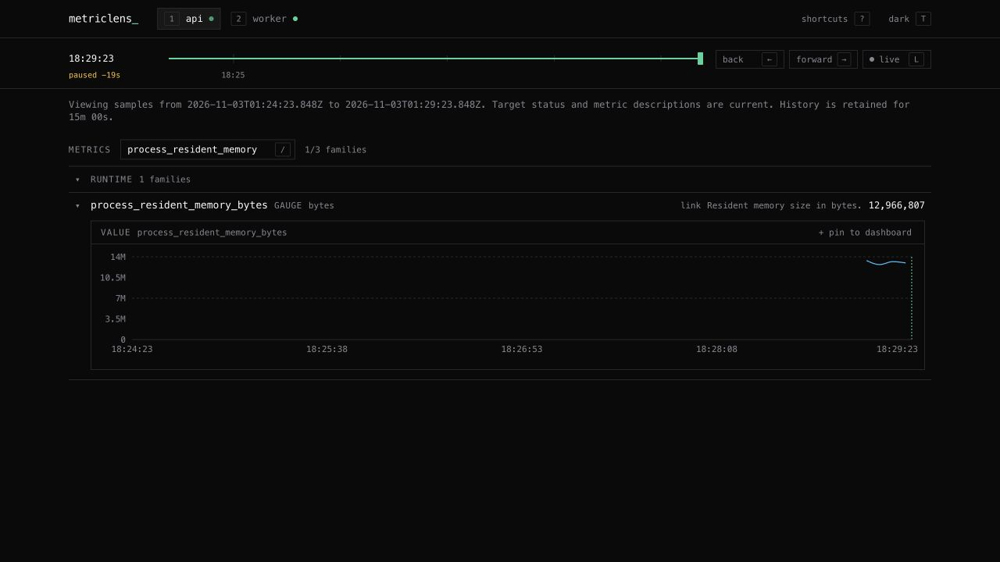
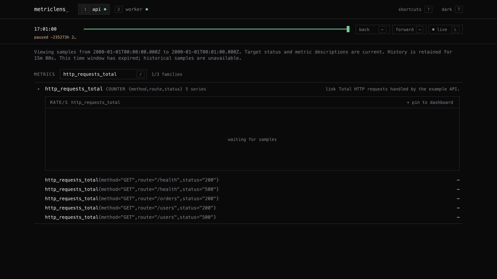

# Product and agent workflow audit

Reviewed on November 2, 2026. This combines repository inspection, automated checks,
official documentation research, and an in-app browser walkthrough of the real
`example/basic` API and worker. Product priorities below are engineering hypotheses,
not evidence from customer interviews or usage analytics.

## Who this serves

The clearest initial audience is a developer or coding agent working on a local
Docker Compose application that already exposes Prometheus metrics. Their useful
loop is: discover the stack, wait for samples, mark a baseline, run an explicit
workload, inspect bounded findings, then show a person the relevant evidence.

Docker distinguishes a running container from a ready application; this supports
keeping readiness and actual scrape freshness visible rather than equating discovery
with health. [Docker startup and readiness documentation](https://docs.docker.com/compose/how-tos/startup-order/).

For an application engineer, useful questions include request throughput, failures
relative to attempts, and latency distributions. These are established instrumentation
patterns; they are not justification for applying the same alert threshold to arbitrary
metrics. [Prometheus instrumentation guidance](https://prometheus.io/docs/practices/instrumentation/).

For an agent, typed tools, bounded outputs, explicit missing evidence, and inspectable
links let the human verify a claim. MetricLens already has MCP discovery, observations,
experiments, and metric evidence; the immediate gap was connecting that evidence to
the browser. [MCP server tools and resources](https://modelcontextprotocol.io/docs/learn/server-concepts).

## Browser walkthrough

The walkthrough used the current frontend against the running backend and real
example workloads. Screenshots were saved and reopened before acceptance.

| Step | Task and observed health | Evidence |
| --- | --- | --- |
| 1 | Open with backend unavailable: the screen identifies the backend failure, although its generic `/metrics` hint offers little recovery guidance. | Local capture `01-start-backend-unavailable.png`; recovery UX remains a follow-up. |
| 2 | Discover API and worker: service tabs, live status, grouped metrics, HELP text, and runtime grouping work. | Local capture `02-live-discovery.png`. |
| 3 | Follow a metric's `link`: the correct service is selected, the metric is filtered and expanded, and the RFC3339 window stays frozen. | [Linked metric screenshot](audit/2026-11-02-linked-metric.png). |
| 4 | Reopen a link after its container was recreated: the old target is explicitly unavailable; another service is not substituted. Selecting an available service recovers navigation. | Local capture `04-target-recreated.png`. |
| 5 | Open an expired time window: the page explains retention and shows unavailable historical values instead of current samples. | [Expired window screenshot](audit/2026-11-02-expired-window.png). |
| 6 | Press Tab: focus reaches a service button. The global handler no longer cancels native Tab navigation. | Browser focus observation and automated regression test. |

## Correctness and workflow fixes in this maintenance pass

- Valid Prometheus label strings containing braces or escaped quotes, and optional
  trailing label commas, are accepted. Oversized scrape responses fail explicitly
  instead of storing a truncated prefix. [Prometheus exposition format](https://prometheus.io/docs/instrumenting/exposition_formats/).
- Valid `NaN` and infinite observations no longer break an entire JSON response.
  They become `null` at JSON interfaces, are excluded from numeric inference, and
  appear as missing values or chart gaps rather than zero.
- Counter resets are handled per label series before rates are aggregated. Sparse
  or duplicate-time samples no longer imply a measured zero rate. The results
  remain sampled estimates, not PromQL's extrapolated `rate()` implementation.
  [Prometheus rate semantics](https://prometheus.io/docs/prometheus/latest/querying/functions/#rate).
- Disappeared targets and expired label series are pruned across scrape cycles.
  Late observations are ordered, baseline-only data is not presented as current,
  and unhealthy or stale targets cannot gain artificial freshness from cached data.
- Findings include a relative `uiUrl`. Query links select a target and metric and
  preserve `start`/`end` in RFC3339; existing target hashes continue working. Current
  target status and metadata are explicitly distinguished from historical samples.
- History request failures are visible. Changing the discovered metric set during
  a pending historical fetch no longer cancels loading permanently. Historical
  windows stay paused when stepping to their right edge, and raw values cannot
  come from samples before the selected start time.
- Native Tab access is restored. The dark muted text token changed from
  `#71717a` to `#868690`: against `#0a0a0a`, its calculated contrast improves from
  4.10:1 to 5.49:1. This addresses that text token, not full accessibility conformance.
  [WCAG keyboard guidance](https://www.w3.org/WAI/WCAG22/Understanding/keyboard.html),
  [WCAG minimum contrast](https://www.w3.org/WAI/WCAG22/Understanding/contrast-minimum.html).

## Prioritized follow-ups

| Priority | Concrete problem | Smallest useful next change |
| --- | --- | --- |
| P1 | The classifier suggests latency and HTTP error-rate panels, but the frontend supports generic gauges and counter rates. A histogram currently plots observation throughput, not latency percentiles. | Add dedicated renderers with units, reset-aware bucket rates, a defined quantile window, and tests against the example workloads. Add an explicit errors/attempts denominator before displaying an error ratio. |
| P1 | Histogram quality checks can combine bucket presence across label variants. One valid variant can hide a malformed one. | Validate each histogram label set separately, excluding `le`; test missing `+Inf`, missing counts, and inconsistent cumulative buckets. |
| P1 | Gauge findings report an aggregate current value but a peak from an individual sample; chart legend collisions can also sum gauges or quantiles with different full label sets. | Define aggregation explicitly and keep label identity for measurements that cannot be added. Prefer bounded per-label evidence over a generic aggregation setting. |
| P1 | Panels and quality requests still have independent empty fallbacks in `loadTargetData`; their failures can look like an absence of panels or warnings. | Keep successfully loaded metrics while displaying which supporting request failed. Test each partial failure. |
| P2 | A new user seeing no discovered metrics has little explanation of probing, excluded services, or labels that would help. | Show discovery/probe state and the existing port/path override next to the empty state, using the backend's bounded discovery output. |
| P2 | Recharts dominates the single frontend bundle; a production build reports a chunk above 500 kB. | Measure the initial experience, then consider loading chart code only when a metric expands. Avoid changing chunk thresholds merely to hide the warning. |
| P2 | Links expire with memory retention and container IDs change on recreation. | Keep the explicit expiration/missing-target behavior. Validate demand for durable exports or service-level navigation before adding storage or new identity rules. |

Histogram percentiles require bucket-aware computation and careful aggregation;
summary quantiles cannot simply be summed or averaged across instances.
[Prometheus histograms and summaries](https://prometheus.io/docs/practices/histograms/).

The existing observation and experiment reports summarize current state and window
changes. Their warning/error severities primarily describe scrape, instrumentation,
and lifecycle problems. They are not a causal regression detector or a universal
business-anomaly model. Any future thresholds should identify a concrete metric,
unit, label scope, baseline, and sufficient sample window. The CLI evaluation's
signal F1 measures configured returned signal names, not anomaly-detection accuracy.

## Dependency maintenance decisions

Build and CI use Go 1.27.3 and Node 26.13.0 LTS; the frontend uses React 19.3.1,
Vite 8.3.5, Vitest 5.1.0, and TypeScript 6.0.3. TypeScript 7 is deferred because
the installed lint tooling supports versions below 6.1.
[typescript-eslint support policy](https://typescript-eslint.io/users/dependency-versions/).
The `minimatch` override to `^11.0.1` addresses
[GHSA-g3hv-75wg-m249](https://github.com/advisories/GHSA-g3hv-75wg-m249);
the full lint/test/build loop passes with the override.

Example images and clients were refreshed to Python 3.15 / prometheus-client 0.26,
Redis 8.10.3 / redis_exporter 1.96, and Pushgateway 1.11.4, with real Compose smoke
checks. Pinned Actions were aligned, npm updates added to Dependabot, Docker CI
added, and the repository dependency graph enabled for the dependency-review gate.
Existing PRs #13, #20, #21, #22, #23, #29, #31, #32, #34, #35, and #36 are
superseded by this combined, verified update and should be closed only after its
replacement merges; #31 also duplicates the API version brought in by the client.

## Verification and limits

Frontend verification used Node 26.13.0, a clean `npm ci`, lint, 103 tests, TypeScript
checking, and the production build. The complete npm audit, including development
dependencies, reported no vulnerabilities at the time of this pass. Backend and
container verification are documented in the maintenance PR.

The final production image was also checked on port 19999 using a real
`/api/report` finding's `uiUrl`, including its nine-digit fractional timestamps.
It selected and expanded the correct runtime metric and displayed actual retained
samples. The historical forward control stayed paused; a pre-restart link showed
unavailable values rather than inventing recovered evidence.

The browser checks cover the desktop example flow, links, missing targets, expired
history, and a native keyboard focus transition. Screen readers, mobile layouts,
zoom/reflow, every color pairing, and real customer workflows were not exhaustively
tested. Screenshots alone cannot establish accessibility conformance. No adoption,
retention, or willingness-to-pay claims were inferred from the Awesome Docker listing.
